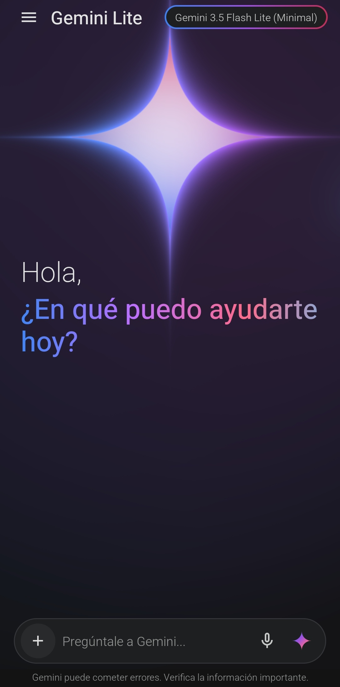
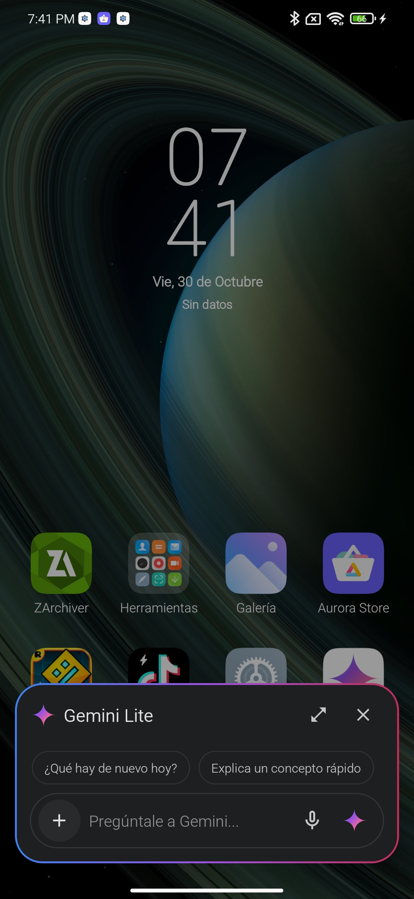

# Gemini Lite

**Gemini Lite** es una alternativa gratuita y compatible con AOSP para contar con las funciones del asistente de Google en Android sin depender de la aplicación oficial ni de motores web pesados (`WebView` / Chromium).

Incluso en teléfonos de gama de entrada actuales, el asistente oficial suele presentar tiempos de carga altos y un consumo excesivo de memoria debido a las capas web y servicios en segundo plano que utiliza. El objetivo de este proyecto es replicar el modo de funcionamiento práctico del asistente (invocación desde el sistema, lectura de pantalla, consultas con imágenes y chat continuo), pero no su interfaz original, reemplazándola por una implementación nativa en Java, C++17 (NDK) y OpenGL ES 2.0 capaz de correr con fluidez hasta en dispositivos del año 2014 (Android 5.0 / API 21+).

## Capturas de pantalla

| Aplicación principal | Asistente del sistema (ventana flotante) |
| :---: | :---: |
|  |  |

## Enfoque del proyecto

- **Libre de motores web**: Toda la interfaz, el formateo de texto Markdown, los bloques de código y la animación de fondo están hechos con componentes nativos de Android y OpenGL. No se instancia ningún `WebView`.
- **Alternativa AOSP y gratuita mediante API Key propia**: No requiere cuentas vinculadas a servicios propietarios en el teléfono ni suscripciones; funciona conectándose directamente a la API de Google AI Studio mediante tu propia clave gratuita.
- **Funcionalidad sobre clonación visual**: No busca calcar el diseño de Google, sino ofrecer la misma utilidad (asistente superpuesto, captura de lo que hay en pantalla, envío de archivos y selección de modelos) con una estética propia y un peso mínimo.

## Uso y configuración de la API Key

La aplicación no incluye claves preconfiguradas ni servidores intermediarios. Cada usuario utiliza su propia API Key de Google AI Studio:

1. **Obtención de la clave**: Se puede generar de forma gratuita desde [Google AI Studio](https://aistudio.google.com/app/apikey) (la propia app incluye un acceso directo en la ventana de configuración).
2. **Configuración en la app**:
   - Abre el menú lateral izquierdo y toca en **Configuración de API** (o intenta enviar un mensaje por primera vez para que se abra el diálogo automáticamente).
   - Pega tu clave (con formato `AIzaSy...`).
3. **Validación y prueba**:
   - Antes de usarla, el módulo nativo en C++ verifica que el formato de la clave sea válido.
   - Puedes presionar **Probar Conexión** para confirmar que la clave responde correctamente con el modelo seleccionado y luego presionar **Guardar**.
4. **Almacenamiento local**: La clave se guarda únicamente en las preferencias locales del dispositivo (`SharedPreferences`) y se utiliza tanto en la aplicación principal como en la ventana flotante del asistente.

## Características

### Modelos y niveles de pensamiento
- Selector integrado en la barra superior para alternar entre:
  - **Gemini 3.8 Flash** (niveles de pensamiento `High`, `Medium`, `Low`)
  - **Gemini 3.5 Flash-Lite** (niveles de pensamiento `High`, `Medium`, `Low`, `Minimal`)
- El cambio de modelo y nivel de pensamiento se aplica al instante tanto para el chat principal como para el asistente del sistema.

### Asistente del sistema (VoiceInteractionService)
- Se registra como aplicación de asistencia digital predeterminada de Android (accesible mediante gesto desde la esquina, botón de inicio o botón de encendido).
- **Modo burbuja flotante (`AssistantOverlayActivity`)**: Se abre sobre cualquier aplicación activa sin cerrar lo que estás haciendo y se ajusta automáticamente al abrir el teclado.
- **Captura de pantalla de la capa inferior**: Desde el botón `+` del asistente se puede capturar directamente la pantalla de la aplicación que está por detrás (`onHandleScreenshot`), sin que la burbuja del asistente aparezca en la imagen.
- **Paso a pantalla completa**: Permite abrir la conversación actual del asistente dentro de la aplicación principal conservando el contexto y los archivos adjuntos.

### Soporte multimodal (imágenes, capturas y archivos)
- Envío de fotografías tomadas con la cámara, archivos del almacenamiento o capturas tomadas desde el asistente.
- Detección del tipo de archivo por cabecera binaria (`JPEG`, `PNG`, `WEBP`, `GIF`, `PDF`) para evitar fallos cuando el sistema devuelve tipos MIME genéricos.
- Manejo conjunto de imagen y texto en el mismo mensaje, manteniendo la imagen activa en la sesión para poder hacer preguntas adicionales sobre ella sin tener que subirla dos veces.

### Interfaz, historial y renderizado
- **Fondo en OpenGL ES 2.0**: Shader escrito en C++ con respuesta al tacto, adaptado a pantalla completa y recortes de cámara (*notch*).
- **Historial local en SQLite**: Guardado automático de conversaciones y referencias de archivos adjuntos en el menú lateral.
- **Markdown y código nativo**: Soporte para encabezados, listas, negritas y bloques de código con resaltado de sintaxis y botón para copiar, todo procesado en memoria sin vistas web.
- **Entrada por voz**: Reconocimiento de voz integrado tanto en la ventana flotante como en la aplicación principal.

## Optimizaciones de rendimiento

Para asegurar que la aplicación funcione a 60 FPS tanto en teléfonos económicos recientes como en hardware antiguo (GPUs Adreno 3xx, Mali-400/T6xx o PowerVR), se aplicaron los siguientes ajustes:

1. **Gráficos (OpenGL ES 2.0)**:
   - Contexto inicializado sin buffers de profundidad ni *stencil* (`setEGLConfigChooser(false)`), reduciendo el uso de VRAM.
   - Cálculos constantes y matrices de rotación resueltos en CPU (C++) una vez por fotograma y pasados como `uniforms`, moviendo las transformaciones lineales al *Vertex Shader*.
   - Al entrar en una conversación o abrir el menú lateral, el shader apaga el cálculo de la estrella central o pausa el ciclo de renderizado (`RENDERMODE_WHEN_DIRTY`) para no consumir batería ni GPU innecesariamente.
2. **Código nativo (NDK)**:
   - Compilado con `-O3 -ffast-math -fno-exceptions -fno-rtti` para arquitecturas de 32 y 64 bits (`armeabi-v7a`, `arm64-v8a`, `x86`, `x86_64`).
3. **Memoria e interfaz**:
   - Miniaturas cargadas con submuestreo (`inSampleSize`) y almacenadas en un `LruCache` bajo formato `RGB_565` (la mitad de consumo en RAM respecto a `ARGB_8888`).
   - El parseo de Markdown y resaltado de sintaxis se guarda en caché por mensaje para no recalcularse al desplazar la lista.

## Estructura del código

```text
GeminiApp/
├── app/src/main/cpp/
│   ├── CMakeLists.txt          # Configuración de compilación NDK (C++17)
│   ├── gemini_jni.cpp          # Enlace JNI entre Java y C++
│   ├── gemini_renderer.h/.cpp  # Renderizador OpenGL ES 2.0
│   └── gemini_api.h/.cpp       # Armado de peticiones JSON, validación de API Key y lectura de respuestas
└── app/src/main/java/com/google/geminiclone/
    ├── MainActivity.java                       # Actividad principal e historial
    ├── AssistantOverlayActivity.java           # Ventana flotante del asistente
    ├── ApiKeyManager.java / ApiKeyDialog.java  # Almacenamiento y diálogo de configuración de API Key
    ├── GeminiVoiceInteractionService.java      # Servicio de asistencia del sistema
    ├── GeminiVoiceInteractionSession.java      # Recepción de captura de pantalla del sistema
    ├── AssistantScreenshotHolder.java          # Referencia en memoria de la última captura
    ├── GeminiGLSurfaceView.java                # Vista de dibujo OpenGL
    ├── GeminiApiClient.java                    # Cliente HTTP asíncrono
    ├── ChatDatabaseHelper.java                 # Base de datos SQLite local
    ├── ChatAdapter.java / GeminiMessageRenderer.java / MarkdownParser.java
    └── ImageThumbnailCache.java / ShimmerTextView.java
```

## Compilación e instalación

### Requisitos
- Android SDK 34, NDK y CMake 3.22.1+
- JDK 17+
- Una API Key de [Google AI Studio](https://aistudio.google.com/app/apikey)

### Compilar desde consola
```bash
./gradlew assembleDebug
adb install -r app/build/outputs/apk/debug/app-debug.apk
```

### Configuración como asistente en Android
1. Abrir **Ajustes -> Aplicaciones -> Aplicaciones predeterminadas -> App de asistencia digital**.
2. Seleccionar **Gemini Lite**.
3. Habilitar los permisos de **"Usar texto en pantalla"** y **"Usar captura de pantalla"** para que el sistema entregue la imagen de fondo al invocar el asistente.
